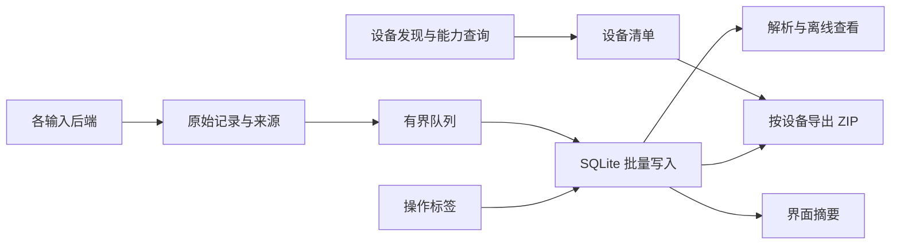

# input-recorder 技术方案

## 目标与范围

状态：待评审方案。本文描述计划行为，仓库尚未实现这些功能。

设备持有者在自己的 Windows 会话中录制操作，导出分析包。分析者在没有实物的情况下，判断设备暴露了哪些接口、每个操作产生哪些报告，以及哪些字段随操作变化。

Windows 为主要平台。覆盖目标包括键盘、鼠标、手柄、摇杆、方向盘、踏板、触控板、触摸屏、数位笔、MIDI 控制器，以及未知的人机接口设备（Human Interface Device，HID）。串口、专有蓝牙协议和厂商接口按适配器扩展。麦克风和摄像头的音视频内容采集不属于本方案；设备上的控制按钮仍属于输入范围。

录制对象是当前登录用户的物理输入动作。普通应用中的后台输入属于目标范围。输入法最终文字、其他用户会话和安全桌面不在首版范围内。设备产生的事件也可能来自固件宏、虚拟驱动或周期性状态报告，因此记录只能证明接口观察到了什么，不能证明每条事件都由人的动作直接触发。

## 技术栈

| 部分 | 选择 | 原因 |
| --- | --- | --- |
| 语言 | Rust，2024 edition | 统一采集、存储和界面代码；通过所有权管理设备句柄和线程资源 |
| 图形界面 | egui / eframe | 适合设备列表、表格、十六进制查看器和简单时间线；直接构建本地应用 |
| Windows 调用 | Microsoft `windows` crate | 使用官方 Windows API 绑定，隔离平台调用 |
| 输入采集 | Raw Input、HID API，以及按设备类别增加的后端 | 保留设备来源和原始数据，兼容不同输入模型 |
| 本地存储 | rusqlite + SQLite，WAL 模式 | 批量写入事件；按设备、会话和时间查询 |
| 导出 | serde / serde_json、CSV、ZIP | JSONL 保存结构化事件，二进制文件保存报告，CSV 用于快速查看 |
| 并发 | 专用采集线程、写入线程、有界通道 | 让磁盘和界面工作不阻塞采集；显式处理过载 |
| 分发 | Windows x64 便携包；随后验证 ARM64 | 降低设备持有者的使用成本；额外运行时需求必须在包内说明 |

推荐采用这一组合。现有组织项目使用 Rust，可以沿用相关经验。Tauri + Vue 适合更复杂的网页式界面，但当前功能会增加前端构建和进程通信工作。C# + WPF 也是可行备选，适合团队更熟悉 .NET 的情况。[egui](https://github.com/emilk/egui) 和 [windows-rs](https://github.com/microsoft/windows-rs) 的官方仓库提供了对应能力和许可说明。

首次实现时固定 Rust 工具链和依赖锁文件，验证依赖许可。GameInput 等可选组件需先验证 Rust 绑定、运行时发现和分发条件。当前方案不预设未经验证的依赖版本，也不承诺单个可执行文件覆盖所有后端。

## 采集覆盖

设备发现、原始数据可读和语义可解析是三个独立维度。设备列表应分别显示这些状态。发现设备后，即使没有输入，也应保留设备快照、尝试过的接口和错误原因。

| 设备或接口 | 采集方式 | 数据与边界 |
| --- | --- | --- |
| 键盘、鼠标 | Raw Input | 按设备记录扫描码、按下与释放、移动、按钮和滚轮；此处的数据是 Windows 的键鼠结构，通常不是 USB 报告原文 |
| 通用 HID、厂商自定义 HID | Raw Input 的 RAWHID；必要时使用共享、只读的 HID ReadFile | 保存完整报告字节、报告大小、批次和能力信息；未知 Usage 也应保留 |
| 手柄、摇杆、方向盘、踏板 | HID 原始报告，加 GameInput 后端 | 保留原始报告和状态；GameInput 负责补充控制器接口覆盖，须验证具体设备和后台接收行为 |
| 旧式 XInput 设备 | 按需增加 XInput 兼容后端 | 保存状态、槽位和采样信息；槽位不能直接充当稳定物理设备标识 |
| 触摸屏、触控板、数位笔 | 可访问的 HID 数据，加 Pointer 诊断画布 | 在本程序画布中记录接触、压力等可用信息；跨应用完整采集需逐类验证，不能保证 |
| MIDI 控制器 | Windows MIDI Services 后端 | 保存端点、消息和原生时间信息；验证运行时是否可用，分别声明 MIDI 1.0 与 MIDI 2.0 的覆盖能力 |
| 串口、自定义 BLE、厂商 SDK | 独立适配器 | 列出候选设备和未支持原因；依据实际协议证据增加支持 |

控制器扩展依据 [GameInput 官方说明](https://learn.microsoft.com/en-us/gaming/gdk/docs/features/common/input/overviews/input-overview)，MIDI 扩展依据 [Windows MIDI Services](https://github.com/microsoft/MIDI)。两者均作为独立后端接入，安装条件和 API 覆盖需在原型阶段实测。

Raw Input 可以区分同类设备，并通过 `RIDEV_INPUTSINK` 接收后台输入。注册应按枚举到的顶层集合 Usage 组合去重，保留未知 Usage，并在热插拔时更新。每次注册和打开设备都记录成功或失败，避免静默漏掉设备。参见 [Raw Input 概览](https://learn.microsoft.com/en-us/windows/win32/inputdev/about-raw-input)。

通用 HID 记录必须处理 `RAWHID` 中的全部报告。一个消息可能包含多个报告，不能只读取第一个。保留每批的报告数量、长度和批内顺序。连续 HID 读取使用 `ReadFile`；不以反复调用 `HidD_GetInputReport` 代替连续采集。参见 [RAWHID](https://learn.microsoft.com/en-us/windows/win32/api/winuser/ns-winuser-rawhid) 和[获取 HID 报告](https://learn.microsoft.com/en-us/windows-hardware/drivers/hid/obtaining-hid-reports)。

普通用户态接口存在覆盖边界。精确式触控板事件的设备句柄可能为零，远程桌面设备不出现在 Raw Input 枚举中。全局 Pointer 重定向需要 UI Access 权限，而且会改变输入路由，因此本方案采用诊断画布作为补充。来源不明的事件独立保存，不能归到任意已知设备。参见 [RAWINPUTHEADER](https://learn.microsoft.com/en-us/windows/win32/api/winuser/ns-winuser-rawinputheader)、[设备枚举](https://learn.microsoft.com/en-us/windows/win32/api/winuser/nf-winuser-getrawinputdevicelist) 和 [Pointer 重定向](https://learn.microsoft.com/en-us/windows/win32/api/winuser/nf-winuser-registerpointerinputtarget)。

## 设备识别与原始证据

为每个逻辑输入接口分配会话内标识，保存设备路径、设备实例 ID、Usage Page、Usage、可用的 VID/PID、序列号、名称、总线、驱动信息和连接时间。字段无法取得时保存空值及原因，不能靠名称猜测。

通过 SetupAPI / Configuration Manager 查询设备属性，并使用 Windows 提供的 Container ID 辅助组合物理设备。一个物理设备可以包含多个逻辑集合；一个无线接收器也可能服务多个实际设备。分组保留依据和不确定性。VID/PID 只能标识型号，运行时句柄只能用于当前连接。无序列号设备跨端口、跨会话的关联不保证稳定。参见 [Container ID](https://learn.microsoft.com/en-us/windows-hardware/drivers/install/container-ids)。

HID 能力快照保存报告长度、报告 ID、按钮和值能力、Usage、逻辑范围、物理范围、单位和链接集合等可用信息。通过 `HidP_*` 解析得到的字段附加在原始报告上，并记录解析器版本。解析失败时仍保存原始报告。参见 [HID 报告解释](https://learn.microsoft.com/en-us/windows-hardware/drivers/hid/interpreting-hid-reports)。

能力快照与原始 HID Report Descriptor 必须区分。Windows 的 preparsed data 是系统内部格式，不能当作标准描述符。标准描述符无法取得时明确标记；只有接口确实提供描述符原文时，才按原始描述符导出。任何字节数据都需注明来自哪个 API、表示哪一层数据。

同一设备通过多个后端产生的记录保留来源。只有可靠的设备关联证据才能合并展示；不按相近时间盲目去重。默认每个接口选择一个主采集路径，补充后端单列，避免把同一动作算成多次。

## 数据流与存储



采集线程负责读取、标记时间并移交数据。界面只订阅限频摘要和有限条预览，不能用界面刷新频率限制原始录制频率。首版使用单个应用 crate 的模块结构，平台调用集中在 Windows 模块；后端增多后再按责任拆分 crate。

每条记录包含会话 ID、逻辑接口 ID、后端、连接代次、后端序号、接收时间、可选设备原生时间、批次信息、原始数据类型及解析状态。使用单调时钟记录时间间隔，保存与 UTC 的关联点和后端时钟换算信息。跨后端时间不能直接当作硬件发生顺序；一个批次中的报告若没有独立时间戳，只能保留批次接收时间和报告顺序。

SQLite 分别保存会话、设备快照、连接事件、输入事件、原始 BLOB、动作标签和诊断记录。索引优先覆盖会话、接口和时间范围。使用一个写入者批量提交，导出使用一致性快照或已停止的会话；大型导出需控制读事务寿命。WAL 支持读写并发，但仍需要管理检查点和文件增长。参见 [SQLite WAL](https://www.sqlite.org/wal.html)。

有界队列溢出时记录已知丢失数量和时间区间，并将会话标为不完整。应用计数只能证明自己的接收与存储情况；驱动或设备上游丢失未必可检测。磁盘满、写入失败和设备移除都需明确显示。停止录制后等待队列写入完成，再显示完成状态。异常退出后保留已提交数据，并标记会话未正常结束。

## 图形界面与操作流程

采用一个主窗口。左侧是按物理设备分组的接口树，显示名称、连接状态、采集能力和实时计数。右侧提供设备详情、事件时间线、原始报告十六进制视图和字段变化。底部提供开始、停止、动作标签和导出。

设备过滤分为录制选择和查看选择。录制选择决定哪些接口写入数据库，在会话开始时固定；查看选择只影响显示。新出现的接口先列为待选择，不静默加入正在录制的设备集合。导出使用独立的设备、会话和时间范围条件，并在开始前展示记录数量。

典型流程：

1. 打开程序，连接未知设备，确认设备及其逻辑接口。
2. 勾选要录制的设备，查看可用后端和缺失能力。
3. 开始录制，先保留一段空闲状态。
4. 用标签划分操作片段，例如“只按按钮 A”“摇杆向左”“踏板从松开到踩到底”。
5. 停止录制，检查计数、错误和已知丢失记录。
6. 导出所选设备的分析包，分析者在另一台电脑中离线打开。

标签通过片段开始与结束时间表达。界面操作本身也可能产生输入，分析包应保留标签时间，便于区分测试动作与标注动作。数位笔和触摸设备提供专用画布，让使用者执行可重复的压力、接触和移动测试。

## 导出格式

主格式为 ZIP 分析包，CSV 是辅助格式。按设备导出时包含选中物理组下的全部已选逻辑接口，保留筛选条件、关联标签和诊断信息。原始记录按接口分别存放。

```text
manifest.json
devices.json
capabilities/<interface-id>.json
events/<interface-id>.jsonl
reports/<interface-id>.bin
markers.jsonl
diagnostics.jsonl
checksums.sha256
```

`manifest.json` 包含格式版本、应用版本、Windows 版本、会话时间、后端版本、筛选条件、时钟定义、记录计数和完整性状态。事件通过偏移和长度引用二进制报告，并包含原始格式标识。只导出选中记录引用的数据，不能通过整库复制带入其他设备的事件。

CSV 提供时间、设备、事件类型和可解析字段，允许附加原始报告十六进制列。JSONL 与二进制数据作为完整分析依据，避免 CSV 丢失嵌套字段、批次关系或原始字节。

分析者可离线查看包内设备清单、动作标签、报告长度分布、报告 ID、相邻报告的字节变化，以及已解析的按钮和轴值。离线分析不需要安装原设备驱动。导入时检查格式版本、文件大小、路径和校验值；硬件报告和外部分析包均按不可信输入处理。

记录和导出默认保存到用户本地目录，由用户明确开始和停止。实际录制数据可能含按键和设备序列号，不应自动进入公开仓库。测试使用构造数据或明确允许公开的样本。

## 实施顺序与验收

首个可用版本以未知 HID 诊断为核心，不能仅完成键鼠监听。其他输入家族逐项增加并验证，“覆盖各类设备”是项目目标，不能作为尚未测试的首版承诺。

| 阶段 | 交付 | 验收条件 |
| --- | --- | --- |
| 1. 设备与数据原型 | 设备树、能力快照、Raw Input 和 HID 采集 | 同时连接同型号设备仍能区分；复合设备保留全部接口；未知 Usage 和无法读取的接口都有记录 |
| 2. 完整录制流程 | 简单界面、SQLite、动作标签、按设备导出 | 每个已接收报告可追溯；停止后记录写入完成；导出没有混入其他设备的原始事件 |
| 3. 离线分析 | 导入分析包、时间线、字节差异、字段视图 | 在没有目标设备和驱动的电脑上分析；未解析报告可完整查看 |
| 4. 输入类别扩展 | GameInput、Pointer 画布、MIDI，按需补充其他适配器 | 每个后端记录实际覆盖范围、设备关联证据和原始数据层级；缺失运行时不影响核心采集 |
| 5. 发布验证 | Windows 便携包、持续集成和硬件覆盖表 | 新环境可启动；高频、热插拔、断连重连、磁盘故障和异常退出有可审查结果 |

数据原型需要验证多个报告 ID、一次消息多个报告、按键释放、负轴值、空闲报告、报告长度变化和无序列号设备。自动测试覆盖解析边界、原始字节往返、筛选隔离、时间换算和过载诊断。性能测试用合成高频流验证队列和存储，再用实际设备核对；未检测到应用丢包不能代替端到端无丢包证明。

当前推荐方案可直接作为后续实现基线。首先完成未知 HID 的“发现、录制、导出、异机分析”流程，再依据真实分析包扩充设备后端。
